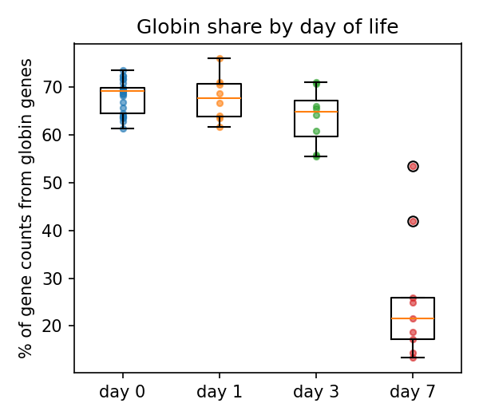
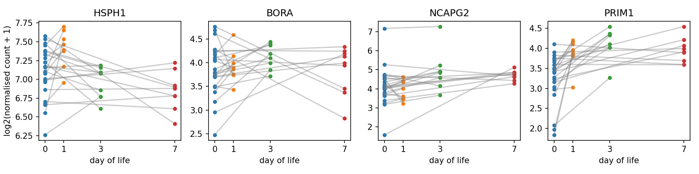

# Do sepsis-signature genes change with age in healthy newborns?

A small pilot on public data. The An et al. (2024) early-onset sepsis signature uses four genes (HSPH1, BORA, NCAPG2, PRIM1) measured in blood at birth. This pilot asks whether those genes change in healthy babies over the first week, which matters if the signature were used on samples taken after birth.

## Data
GEO [GSE111404](https://www.ncbi.nlm.nih.gov/geo/query/acc.cgi?acc=GSE111404) (Lee et al. 2019, *Nat Commun*): whole-blood RNA-seq from 25 healthy term newborns in The Gambia (EPIC cohort). Every baby was sampled on day 0 and once more on day 1 (n=8), day 3 (n=8) or day 7 (n=9). That makes 50 samples.

## Method
1. `pilot.py` downloads the counts and sample information and builds one counts table (58,051 genes x 50 samples).
2. `genes.py`:
   - Measures the share of all gene counts that come from globin genes, by day of life.
   - Removes the globin genes and normalises with DESeq2-style median-of-ratios size factors. Lee et al. 2019 also removed globin. To separate the two ingredients, it also reports results under CPM and under median-of-ratios with globin kept.
   - Pairs each baby's day-0 sample with its later sample (25 pairs, checked), computes the change in log2(normalised count + 1), and tests it with a paired Wilcoxon signed-rank test. P-values for the four signature genes (the primary family) are Benjamini-Hochberg adjusted.
   - Reports the change separately for each later day (day 1, 3, 7) with 95% confidence intervals, day-0 expression levels of the signature genes, and a leave-one-baby-out sensitivity analysis for PRIM1.
3. `pca.py` runs a PCA on the 2,000 most variable genes using the same globin-free normalisation, and reports how PC1 and PC2 are associated with day of life and sex (association only).

All tables go to `results/` and all figures to `figures/`.

## Results
> **Being updated.** The code was revised after review (per-day estimates, multiple-testing correction, PCA on the final normalisation). The numbers below are from the first run and will be replaced once the revised scripts are re-run.

| Gene | Role | Mean change (log2) | Up in | p (unadjusted) |
|---|---|---|---|---|
| HSPH1 | signature | -0.04 | 14/25 | 0.87 |
| BORA | signature | +0.11 | 16/25 | 0.21 |
| NCAPG2 | signature | +0.39 | 17/25 | 0.03 |
| PRIM1 | signature | +0.69 | 21/25 | 1e-05 |
| ISG15 | expected to rise (Lee 2019) | +1.34 | 23/25 | 4e-06 |
| IFI44L | expected to rise (Lee 2019) | +1.58 | 19/25 | 3e-04 |
| MMP8 | expected to fall (Lee 2019) | -2.16 | 1/25 | 2e-07 |
| ACTB | housekeeping | +0.21 | 20/25 | 1e-04 |
| GAPDH | housekeeping | +0.01 | 13/25 | 0.98 |

- **Sanity check:** the genes reported by Lee 2019 move in the expected directions. This supports, but does not validate, the pipeline. ACTB still shows a small but consistent rise, so it is not a perfectly flat control.
- **PRIM1** showed a consistent paired increase in healthy babies (21 of 25).
- **NCAPG2** showed a weaker increase that may not survive multiple-testing correction.
- **HSPH1 and BORA:** no statistically detectable change in this pilot. With 25 babies this does not show that they are stable.

### Scope
This pilot shows expression changes in **healthy** newborns only. It cannot show that age causes false positives or reduces the signature's accuracy, and the signature was designed for samples taken at birth. The relevant question is whether the signature could be **extended to samples taken later in the first week**.




## Limitations
- The sample is small (8-9 babies per later day), and no baby was sampled on all four days.
- All babies are term babies from one population (The Gambia).
- The samples are bulk blood, so a change can reflect a shift in cell mix rather than a change in gene activity. That matters here because these are cell-cycle genes.
- Gene symbols come from a live MyGene query; the query date and ambiguous IDs are saved in `results/`.
- The analysis uses Python with simplified methods; the standard approach is DESeq2 or limma in R, with cell-composition adjustment.

## How to run
```
pip install -r requirements.txt
python pilot.py
python genes.py
python pca.py
```

## References
- Lee AH et al. 2019. Dynamic molecular changes during the first week of human life follow a robust developmental trajectory. *Nat Commun* 10:1092.
- An AY et al. 2024. Predictive gene expression signature diagnoses neonatal sepsis before clinical presentation. *eBioMedicine* 110:105411.
