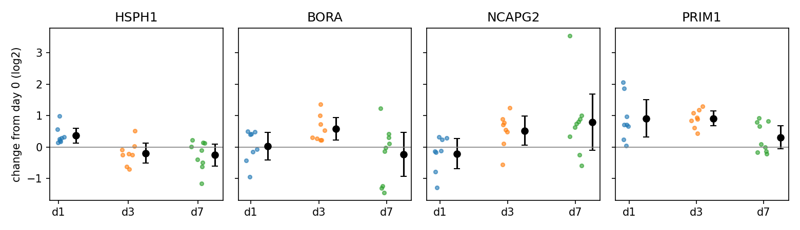

# Do sepsis-signature genes change with age in healthy newborns?

A small pilot on public data. The An et al. (2024) early-onset sepsis signature uses four genes (HSPH1, BORA, NCAPG2, PRIM1) measured in blood at birth. This pilot asks whether those genes change in healthy babies over the first week, which matters if the signature were used on samples taken after birth.

## Data
GEO [GSE111404](https://www.ncbi.nlm.nih.gov/geo/query/acc.cgi?acc=GSE111404) (Lee et al. 2019, *Nat Commun*): whole-blood RNA-seq from 25 healthy term newborns in The Gambia (EPIC cohort). Every baby was sampled on day 0 and once more on day 1 (n=8), day 3 (n=8) or day 7 (n=9). That makes 50 samples.

## Method
1. `pilot.py` downloads the counts and sample information and builds one counts table (58,051 genes x 50 samples).
2. `genes.py`:
   - Measures the share of all gene counts that come from globin genes, by day of life.
   - Removes the globin genes and normalises with DESeq2-style median-of-ratios size factors. Lee et al. 2019 also removed globin. To separate the two ingredients, it also reports results under CPM and under median-of-ratios with globin kept.
   - Pairs each baby's day-0 sample with its later sample (25 pairs, checked), computes the change in log2(normalised count + 1), and tests it with a paired Wilcoxon signed-rank test. P-values for the four signature genes (the primary family) are Benjamini-Hochberg adjusted.
   - Reports the change separately for each later day (day 1, 3, 7) with 95% confidence intervals, day-0 expression levels of the signature genes, and a leave-one-baby-out sensitivity analysis for PRIM1.
3. `pca.py` runs a PCA on the 2,000 most variable genes using the same globin-free normalisation, and reports how PC1 and PC2 are associated with day of life and sex (association only).

All tables go to `results/` and all figures to `figures/`.

## Results
All numbers below are in `results/`. Change = later sample minus day-0 sample, in log2(normalised count + 1), within each baby.

### 1. Signature genes, change by later day (mean, 95% CI, babies up / n)

| Gene | Day 1 (n = 8) | Day 3 (n = 8) | Day 7 (n = 9) |
|---|---|---|---|
| HSPH1 | +0.37 (0.13 to 0.60), 8/8 | -0.20 (-0.51 to 0.12), 2/8 | -0.25 (-0.60 to 0.10), 4/9 |
| BORA | +0.03 (-0.41 to 0.46), 4/8 | +0.58 (0.23 to 0.93), 8/8 | -0.23 (-0.93 to 0.47), 4/9 |
| NCAPG2 | -0.21 (-0.68 to 0.26), 3/8 | +0.52 (0.06 to 0.98), 7/8 | +0.79 (-0.11 to 1.69), 7/9 |
| PRIM1 | +0.91 (0.31 to 1.51), 8/8 | +0.91 (0.67 to 1.15), 8/8 | +0.31 (-0.06 to 0.68), 5/9 |

### 2. Pooled over all later days (n = 25)

| Gene | Mean change (95% CI) | Up in | p | p, BH-adjusted (4 signature genes) |
|---|---|---|---|---|
| HSPH1 | -0.04 (-0.23 to 0.15) | 14/25 | 0.87 | 0.87 |
| BORA | +0.11 (-0.19 to 0.41) | 16/25 | 0.21 | 0.28 |
| NCAPG2 | +0.39 (0.01 to 0.76) | 17/25 | 0.030 | 0.059 |
| PRIM1 | +0.69 (0.45 to 0.93) | 21/25 | 1.0e-05 | 4.0e-05 |
| ISG15 | +1.34 (0.80 to 1.88) | 23/25 | 4.2e-06 | - |
| IFI44L | +1.58 (0.82 to 2.34) | 19/25 | 3.3e-04 | - |
| MMP8 | -2.16 (-2.63 to -1.70) | 1/25 | 1.8e-07 | - |
| ACTB | +0.21 (0.12 to 0.30) | 20/25 | 1.2e-04 | - |
| GAPDH | +0.01 (-0.15 to 0.16) | 13/25 | 0.98 | - |

### What the results show
- **PRIM1** was higher than day 0 in all 16 babies sampled on day 1 or 3 (about +0.9 log2), and less clearly by day 7 (+0.31, CI includes 0). This looks like an early rise that partly settles, not a steady increase with age. The pooled result survived correction and leave-one-baby-out (mean +0.64 to +0.73, all p < 3e-05).
- **NCAPG2** rose by day 3, but the pooled result does not survive correction (adjusted p = 0.059).
- **HSPH1 and BORA:** no consistent change across days. Each shows one day with a small shift (HSPH1 on day 1, BORA on day 3), which could be chance with 8 babies per group. With this sample size, absence of a detectable change does not show stability.
- **Sanity checks:** ISG15, IFI44L and MMP8 move in the directions reported by Lee 2019. This supports, but does not validate, the pipeline. ACTB shows a small but consistent rise (+0.21), so it is not a perfectly flat control. GAPDH dips slightly on day 1.
- **Low counts:** at day 0 the median raw count is 8 for PRIM1, 10 for BORA and 13 for NCAPG2 (121 for HSPH1). At these levels a +1 change in log2(count + 1) is not exactly a doubling, and estimates are noisy.

### 3. What fixed the normalisation?
Mean pooled change under three normalisations (`results/normalisation_comparison.csv`):

| Gene | CPM, globin kept | Median-of-ratios, globin kept | Median-of-ratios, globin removed |
|---|---|---|---|
| ACTB | +1.11 | +0.21 | +0.21 |
| GAPDH | +0.91 | +0.01 | +0.01 |
| PRIM1 | +1.05 | +0.69 | +0.69 |

The falling globin share (about 68% of gene counts on days 0-1, 26% on day 7) distorts **CPM**. Median-of-ratios normalisation already resists it, with or without globin, so the correction comes from the normalisation method, not from removing globin itself. Globin removal is kept to match Lee et al. 2019.

### 4. PCA (globin removed, same normalisation)
PC1 explains 48% of the variance and is strongly associated with day of life (Spearman rho = -0.80, p = 4e-12). PC2 explains 6% and is associated with sex (p = 6e-08). These are associations, not causes.

### Scope
This pilot shows expression changes in **healthy** newborns only. It cannot show that age causes false positives or reduces the signature's accuracy, and the signature was designed for samples taken at birth. The relevant question is whether the signature could be **extended to samples taken later in the first week**. For comparison, An et al. 2024 (Table S4) report PRIM1 about 0.82 log2 higher at birth in babies who later developed early-onset sepsis than in healthy babies, similar in size to the day 1-3 change seen here (different methods, so only a rough comparison).




## Limitations
- The sample is small (8-9 babies per later day), and no baby was sampled on all four days.
- All babies are term babies from one population (The Gambia).
- The samples are bulk blood, so a change can reflect a shift in cell mix rather than a change in gene activity. That matters here because these are cell-cycle genes.
- Gene symbols come from a live MyGene query; the query date and ambiguous IDs are saved in `results/` when the lookup runs.
- The leave-one-out check does not address selection of which genes to study; the four genes were fixed in advance by An et al. 2024.
- The analysis uses Python with simplified methods; the standard approach is DESeq2 or limma in R, with cell-composition adjustment.

## How to run
```
pip install -r requirements.txt
python pilot.py
python genes.py
python pca.py
```

## References
- Lee AH et al. 2019. Dynamic molecular changes during the first week of human life follow a robust developmental trajectory. *Nat Commun* 10:1092.
- An AY et al. 2024. Predictive gene expression signature diagnoses neonatal sepsis before clinical presentation. *eBioMedicine* 110:105411.
